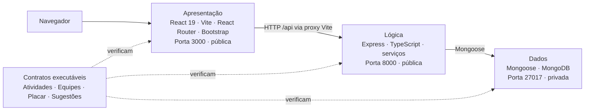

# Arquitetura do OctoFit Tracker

O OctoFit Tracker é uma aplicação de três camadas para um programa de atividades físicas escolar. O código inicial inclui contratos de API e pontos de implementação intencionalmente incompletos para que você use o modo agent do GitHub Copilot em um ciclo guiado por testes.

## Limites entre as camadas

- **Camada de apresentação**: React 19, Vite, React Router, Bootstrap e um cliente compartilhado da API em `octofit-tracker/frontend/src`.
- **Camada de lógica**: rotas e serviços Express com TypeScript em `octofit-tracker/backend/src` expõem o comportamento `/api/*` na porta `8000`.
- **Camada de dados**: modelos Mongoose e dados de demonstração em `octofit-tracker/backend/src/models` e `src/scripts/seed.ts` são persistidos no MongoDB na porta `27017`.

## Portas e regras de ambiente

- MongoDB: `27017` (privada)
- API Express: `8000` (pública)
- Interface Vite: `3000` (pública)
- O navegador acessa caminhos relativos `/api`. O Vite os encaminha para `http://localhost:8000`; `VITE_API_BASE_URL` pode substituir a URL-base.
- Não encaminhe nem torne públicas outras portas.

## Contrato da API

| Capacidade | Método e caminho | Comportamento esperado |
| --- | --- | --- |
| Registro de atividades | `GET /api/activities`, `POST /api/activities` | Lista e cria atividades válidas. POST recebe `userId`, `teamId`, `type` e `minutes`; `userId` e `teamId` devem ser IDs bem-formados de uma pessoa e uma equipe existentes, caso contrário a API retorna um 4xx intencional (nunca um 500 causado por erro de conversão). Uma atividade criada armazena `user`, `team`, `type` e `minutes` enviados, além de `points` e `occurredAt` calculados. |
| Equipes | `GET /api/teams`, `POST /api/teams` | Lista e cria equipes com integrantes. As equipes criadas e listadas mantêm os valores enviados em `name` e `mascot`. Rejeita uma equipe sem nome com `400`. |
| Placar | `GET /api/leaderboard` | Retorna as equipes ordenadas pela soma dos pontos de suas atividades, da maior para a menor. Cada item contém `teamName`, `totalPoints` e uma `rank` iniciada em 1. |
| Sugestões de treino | `GET /api/workouts/suggestions/:userEmail` | Recomenda treinos com base nos padrões de atividade recentes da pessoa correspondente ao e-mail seed. O foco da primeira sugestão (`focus`) corresponde à meta ou à atividade recente dessa pessoa, e o campo `reason` explica o motivo. Um e-mail sem pessoa correspondente retorna um 4xx intencional (por exemplo, `404`). |

## Decisões de implementação

Registre seu plano aqui antes de editar o código.

- Decisão da camada de apresentação:
- Decisão da camada de apresentação: React apresenta atividades, equipes, placar e sugestões; os componentes consomem a API pelo cliente compartilhado e exibem textos em português.
- Decisão da camada de lógica: Express mantém rotas finas e delega validação de entrada e regras de negócio a serviços TypeScript, retornando erros 4xx intencionais.
- Decisão da camada de dados: Mongoose define campos obrigatórios e referências entre pessoas, equipes e atividades; o seed usa chaves estáveis e upserts sem limpar registros existentes.
- Abordagem para registro de atividades: validar IDs e existência das referências antes de salvar; calcular pontos e data no servidor e persistir usuário, equipe, tipo e duração.
- Abordagem para gerenciamento de equipes: exigir nome e mascote, manter integrantes como referências com lista vazia por padrão e sincronizar associações ao mover uma pessoa.
- Abordagem para o placar: somar os pontos das atividades por equipe, ordenar do maior total para o menor e atribuir posições iniciadas em 1.
- Abordagem para sugestões de treino: localizar a pessoa pelo e-mail e recomendar treinos a partir da meta e das atividades recentes, explicando o motivo em português.

## Plano de testes

Registre os comandos executados e o significado de cada falha.

- `npm ci --prefix octofit-tracker/backend`: concluído; instalou as dependências do backend.
- `npm run test:data --prefix octofit-tracker/backend`: 5/5 testes passaram após a validação dos esquemas; a linha de base tinha 4 falhas de campos obrigatórios.
- `node .github/scripts/grade-step.mjs step1-architecture`: aprovado após preencher as sete decisões e abordagens.
- `node .github/scripts/grade-step.mjs step2-data`: aprovado após o grader passar a aceitar `idempotently` e `idempotente`; o contrato protegido permaneceu intacto.
- `node .github/scripts/grade-step.mjs step3-api`: aprovado após implementar atividades, equipes, placar e sugestões.
- `npm run seed --prefix octofit-tracker/backend`: executado duas vezes; ambas concluíram sem erro. O banco terminou com 2 pessoas, 2 equipes, 2 atividades e 2 treinos.
- Compilação do backend: `npm run build --prefix octofit-tracker/backend` passou.
- Testes da API: `npm run test:api --prefix octofit-tracker/backend` passaram (4/4).
- Verificação HTTP local: `GET /api/activities` retornou 200 e `POST /api/activities` com `{}` retornou 400.
- Testes do frontend: `npm test --prefix octofit-tracker/frontend` (pendente para a etapa 4).
- Compilação do frontend: `npm run build --prefix octofit-tracker/frontend` (pendente para a etapa 4).
